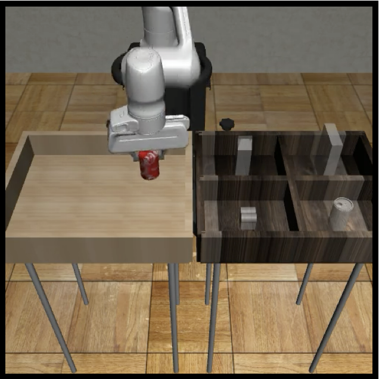
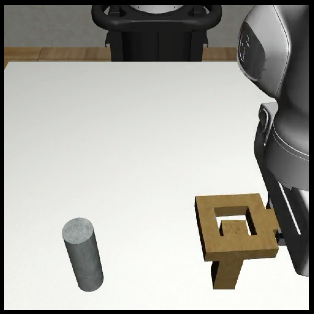
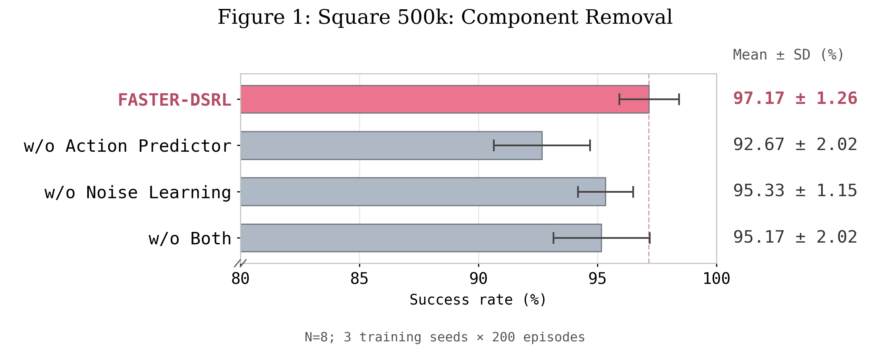
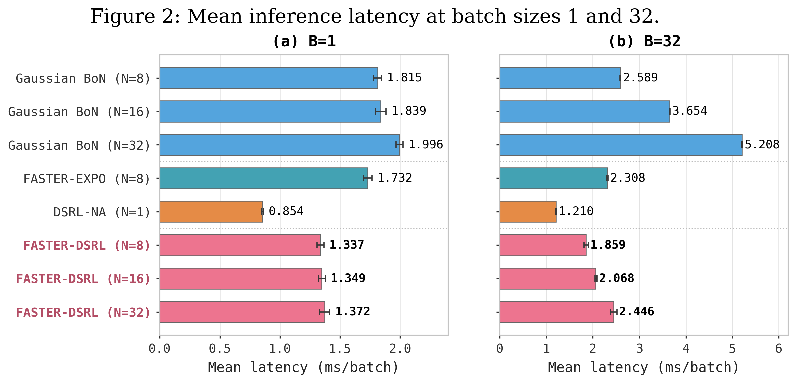
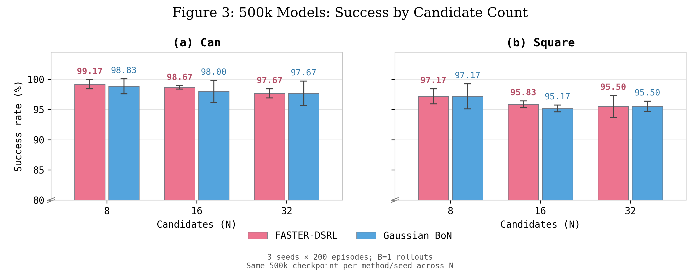

# FASTER-DSRL

**Learn noise proposals, rank predicted actions, and decode only the selected candidate.**

FASTER-DSRL adapts a frozen diffusion policy with reinforcement learning. A noise actor proposes candidates, a lightweight Action Predictor estimates their decoded actions, and the current action critic selects the most promising candidate. The original diffusion policy then decodes that candidate once to produce the executed action chunk.

This repository contains the low-dimensional Robomimic **Can (MH)** and **Square (PH)** implementation. It builds on [FASTER](https://github.com/alexanderswerdlow/faster) and [DSRL](https://github.com/ajwagen/dsrl).

## Method


*Training and action selection. Dashed arrows indicate learning paths; $\operatorname{sg}$ denotes stop-gradient.*

For state $s$, the actor draws $N=8$ independent candidates:

$$
\begin{aligned}
\epsilon_i &\sim \mathcal{N}(0,I), \qquad i=1,\ldots,N, \\
z_i &= 1.5\,\tanh\!\left(\mu(s)+\sigma(s)\odot\epsilon_i\right), \\
\widehat{a}_i &= g(s,z_i), \\
i^\star &= \underset{i\in\{1,\ldots,N\}}{\arg\max}\;\min_{j\in\{1,2\}} Q_{A,j}(s,\widehat{a}_i), \\
a &= D(s,z_{i^\star}).
\end{aligned}
$$

The Action Predictor is trained by supervised regression to the frozen decoder's output:

$$
\mathcal{L}_g = \operatorname{MSE}\!\left(g(s,z),\operatorname{sg}\!\left[D(s,z)\right]\right).
$$

Its predictions are used for ranking; the executed action always comes from $D$.

The action critic $Q_A$ learns from environment rewards and bootstrapped action values. The noise critic $Q_z$ learns detached action-critic targets on actual decoded actions and supplies the noise actor's learning signal. The final selector uses $g + Q_A$; $Q_z$ remains part of actor training. Cached $(s,z,D(s,z))$ mappings are reused with current critic targets.

### Pretraining and initialization

Before RL, we train one diffusion BC policy per task for **50,000 optimizer updates** with **batch size 256**, using **300 Can (MH) demonstrations** or **200 Square (PH) demonstrations**. The seed-42 EMA checkpoint at update 50,000 is frozen and shared across RL seeds 42, 43, and 44 for that task.

Each RL run collects approximately **4,000 primitive environment steps** with the frozen BC policy, then performs **2,000 action-critic updates** and **1,000 noise-critic updates**. Its Action Predictor is pretrained for **50,000 supervised updates**, with batch size 256 and learning rate $3\times10^{-4}$, on cached $(s,z,D(s,z))$ mappings. This Predictor pretraining requires no additional environment interaction. The **500,000-step interaction budget includes the initial collection**; offline optimizer updates are counted separately.

## Experiments

| Can (MH) | Square (PH) |
| :---: | :---: |
|  |  |

*Simulation images from [Robomimic](https://robomimic.github.io/docs/datasets/robomimic_v0.1.html). Policies observe low-dimensional state.*

### Learning performance

Success rate (%) on three RL seeds (42, 43, 44), with 200 evaluation episodes per seed. Values are **mean $\pm$ sample standard deviation**. The step columns refer to primitive environment interactions, not optimizer updates. Each task uses a shared, task-specific BC checkpoint.

| Task | Method | 50k | 100k | 250k | 500k |
| --- | --- | ---: | ---: | ---: | ---: |
| Can | FASTER-EXPO | $89.67 \pm 3.21$ | $90.67 \pm 0.76$ | $92.33 \pm 1.26$ | $93.33 \pm 2.02$ |
| Can | DSRL-NA | $72.67 \pm 3.40$ | $91.50 \pm 6.73$ | $97.50 \pm 2.60$ | $97.50 \pm 0.00$ |
| Can | **FASTER-DSRL** | $\mathbf{98.17 \pm 0.76}$ | $\mathbf{98.00 \pm 1.73}$ | $\mathbf{98.83 \pm 1.26}$ | $\mathbf{99.17 \pm 0.76}$ |
| Square | FASTER-EXPO | $83.67 \pm 0.29$ | $79.83 \pm 1.61$ | $87.83 \pm 2.52$ | $88.33 \pm 3.06$ |
| Square | DSRL-NA | $65.00 \pm 3.77$ | $78.17 \pm 0.76$ | $91.33 \pm 1.04$ | $\mathbf{97.17 \pm 1.26}$ |
| Square | **FASTER-DSRL** | $\mathbf{88.83 \pm 3.69}$ | $\mathbf{91.17 \pm 1.44}$ | $\mathbf{93.17 \pm 2.75}$ | $\mathbf{97.17 \pm 1.26}$ |

At 50k interactions, FASTER-DSRL improves the observed mean over DSRL-NA by 25.50 percentage points on Can and 23.83 points on Square. At 500k, its Square mean equals DSRL-NA's. These comparisons match task and interaction budget; they do not equalize total training computation or update schedules.

### Component ablations



Square, 500k interactions, three seeds × 200 episodes:

| Condition | Candidate selector | Noise actor | Success (%) |
| --- | --- | --- | ---: |
| Full FASTER-DSRL | Action Predictor + $Q_A$ | Learned | $\mathbf{97.17 \pm 1.26}$ |
| Without Action Predictor | $Q_z$ | Learned | $92.67 \pm 2.02$ |
| Without noise learning | Action Predictor + $Q_A$ | Frozen initial actor | $95.33 \pm 1.15$ |
| Without both | $Q_z$ | Frozen initial actor | $95.17 \pm 2.02$ |

All conditions execute one original decoder output and retain critic learning. The frozen initial actor is state-conditioned; it is not a standard Gaussian proposal. The Action Predictor's observed contribution with noise learning enabled is 4.50 percentage points at this endpoint.

### Inference latency



Reported RTX 3090 FP32 latency, in **milliseconds per batch**, at eight candidates unless noted:

| Method | Candidates | Batch $1$ | Batch $32$ |
| --- | ---: | ---: | ---: |
| Gaussian Best-of-N | $8$ | $1.815$ | $2.589$ |
| FASTER-EXPO | $8$ | $1.732$ | $2.308$ |
| DSRL-NA (JAX port) | $1$ | $0.854$ | $1.210$ |
| FASTER-DSRL | $8$ | $\mathbf{1.337}$ | $\mathbf{1.859}$ |
| FASTER-DSRL | $16$ | $1.349$ | $2.068$ |
| FASTER-DSRL | $32$ | $1.372$ | $2.446$ |

At $N=8$, the displayed FASTER-DSRL implementation takes 26.3% less time for batch 1 and 28.2% less for batch 32 than the displayed Gaussian Best-of-N implementation. These measurements include host observation input and synchronized host action output, and exclude compilation, loading, timestep-cache preparation, and simulator execution.

The table combines recorded measurement sessions and implementation versions: the Gaussian BoN/FASTER-EXPO measurements precede the optimized FASTER-DSRL measurements, and DSRL-NA was separately remeasured after a JAX port. The percentages describe these implementations, not an isolated algorithm-only speedup. Single-candidate DSRL-NA is faster in this table.

### Candidate count



The Gaussian BoN success-rate comparator uses an independently trained policy. Increasing candidate count did not monotonically improve success: FASTER-DSRL's Square 500k means were 97.17%, 95.83%, and 95.50% for $N=8$, $16$, and $32$. The default is $N=8$.

### Candidate selection quality

Candidate selection on Square at 500k interactions, using three seeds × 64 shared states and eight candidates per state. Values are **mean $\pm$ sample standard deviation** across seeds.

| Metric | FASTER-EXPO | Noise Critic $Q_z$ | Action Predictor + $Q_A$ |
| --- | ---: | ---: | ---: |
| Top-1 selection accuracy (%) ↑ | $22.40 \pm 5.02$ | $27.60 \pm 5.02$ | $\mathbf{48.96 \pm 3.25}$ |
| Pairwise ranking agreement (%) ↑ | $55.06 \pm 0.42$ | $62.57 \pm 2.87$ | $\mathbf{77.70 \pm 1.38}$ |
| Mean value loss ($\times10^{-3}$) ↓ | $4.62 \pm 1.96$ | $5.99 \pm 1.61$ | $\mathbf{3.24 \pm 0.98}$ |

The reference ranks the eight fully decoded candidates with the current action critic. Top-1 accuracy measures selection of the highest-valued candidate; pairwise agreement measures agreement on candidate ordering. Mean value loss is the action-critic value gap between the reference's best candidate and the selected candidate.

The $Q_z$ and Predictor diagnostics use the same final checkpoint, critic, and candidate bank. FASTER-EXPO uses its own critic, so its absolute value loss is not directly comparable with theirs. These diagnostics measure agreement with learned values, not environment returns or rollout success. All candidates are decoded only to compute the diagnostic reference.

## Training contract

| Setting | Value |
| --- | --- |
| Observation | 23D raw state: end-effector position, quaternion, gripper position, object state |
| Action | 7D per primitive step |
| Prediction / execution horizon | $H=C=4$ (28D flattened chunk) |
| Frozen base | BC EMA after 50k updates; deterministic 10-step FASTER DDIM |
| Training / evaluation candidates | 8 learned / 8 learned |
| Noise actor | $256 \times 3$; learning rate $3\times10^{-4}$ |
| Action Predictor | $1024 \times 3$, LayerNorm and tanh; learning rate $3\times10^{-4}$ |
| Twin action / noise critics | $1024 \times 3$ / $512 \times 3$ |
| Batch / offline fraction | 256 / 0.5 |
| Primitive discount | 0.99 |
| Initial collection / critic calibration | 4k primitive steps / 2k $Q_A$ + 1k $Q_z$ updates |
| Predictor calibration | 50k supervised updates |
| Updates per decision | 4 $Q_A$, 4 $Q_z$, 4 Predictor, 1 actor |
| Temperature | Automatic until 50k primitive steps; then retain that run's temperature state |
| Evaluation horizon | Can: 500; Square: 400 primitive steps |

For an actual execution length $k$, replay stores discounted rewards and a $\gamma^k$ bootstrap discount. Terminal and truncated chunks follow the existing validity-mask contract. The decoder stays frozen throughout RL. Actor entropy is defined in normalized noise coordinates, and the action-critic target contains no entropy bonus.

## Setup

Use Linux, Python 3.10, an NVIDIA GPU compatible with CUDA 12, and [uv](https://docs.astral.sh/uv/). The lockfile retains the experiment's dependency versions and pinned Robomimic/Robosuite revisions.

```bash
uv sync --locked
uv run --locked wandb login
```

Training and evaluation use online W&B logging. Run the commands below from the repository root in the same shell. Set `CUDA_VISIBLE_DEVICES` to the GPU to use if needed.

### Data

Set the dataset directory, then prepare the task datasets:

```bash
export ROBOMIMIC_DATASETS_PATH=/absolute/path/to/robomimic
export MUJOCO_GL=egl
export PYOPENGL_PLATFORM=egl
uv run --locked python scripts/download_robomimic_datasets.py \
  --envs can --splits mh --hdf5-types image --compress-images
uv run --locked python scripts/download_robomimic_datasets.py \
  --envs square --splits ph --hdf5-types image --compress-images
```

Image conversion requires a working MuJoCo EGL setup. The recorded runs used `can/mh/image_v141.hdf5` and `square/ph/image_v141.hdf5`, converted with `done_mode=2`. The policy reads only their low-dimensional fields. After trimming each demonstration at its first terminal transition, Can contains 61,548 transitions and Square contains 29,348.

Verify that the prepared transitions and environment metadata match the training data:

```bash
uv run --locked python - <<'PY'
import os
from pathlib import Path
from faster.data.action_chunk import ActionChunkSpec
from faster.data.dsrl_runtime import make_raw_dataset

root = Path(os.environ["ROBOMIMIC_DATASETS_PATH"])
expected = {
    "can/mh": "f35e226facf0c4f239b3ccfbef62cb39bcb128db46b6decb7aaedf3cd47fc5b7",
    "square/ph": "f89ff310bead6c0bcef5567a4b7fb1b4dee05bf690e42eaf9685d54ecb3cd06b",
}
for task, digest in expected.items():
    _, metadata = make_raw_dataset(
        root / task / "image_v141.hdf5", ActionChunkSpec(4, 4, 7), .99, seed=42
    )
    if metadata["dataset_sha256"] != digest:
        raise RuntimeError(f"Training data mismatch: {task}")
    print(task, metadata["num_demos"], metadata["num_transitions"], "verified")
PY
```

The content hashes cover the selected transitions and environment metadata; image compression and file location do not affect them. Preparation and training also verify dataset content against their input checkpoint.

## Training and evaluation

This workflow trains one seed-42 BC policy per task, prepares and trains RL seeds 42, 43, and 44, and evaluates all four checkpoints in the learning-performance table. Training and evaluation use low-dimensional observations without rendering.

```bash
set -euo pipefail
export RUN_ROOT=runs/faster-dsrl
export DSRL_RUN_GROUP=faster-dsrl
export MUJOCO_GL=glx
unset PYOPENGL_PLATFORM

for task in can square; do
  if [ "$task" = can ]; then split=mh; else split=ph; fi
  dataset="$ROBOMIMIC_DATASETS_PATH/$task/$split/image_v141.hdf5"
  bc_dir="$RUN_ROOT/$task/bc"

  # Train the shared BC policy: 50k optimizer updates, seed 42.
  DSRL_RUN_NAME="$task-bc" uv run --locked python train_faster_dsrl.py bc \
    --task "$task" --dataset "$dataset" --output "$bc_dir"

  for seed in 42 43 44; do
    run_dir="$RUN_ROOT/$task/s$seed"

    # Collect 4k primitive steps, then calibrate Q_A and Q_z.
    DSRL_RUN_NAME="$task-s$seed-prepare" uv run --locked python train_faster_dsrl.py prepare \
      --task "$task" --dataset "$dataset" --seed "$seed" \
      --checkpoint "$bc_dir/bc_50000.pkl" --output "$run_dir/shared"

    # Pretrain the Predictor for 50k updates, then run RL to 500k interactions.
    DSRL_RUN_NAME="$task-s$seed-train" uv run --locked python train_faster_dsrl.py train \
      --task "$task" --dataset "$dataset" \
      --checkpoint "$run_dir/shared/shared.pkl" --output "$run_dir/train"

    for step in 50000 100000 250000 500000; do
      DSRL_RUN_NAME="$task-s$seed-eval-$step" uv run --locked python train_faster_dsrl.py evaluate \
        --task "$task" --dataset "$dataset" --episodes 200 \
        --checkpoint "$run_dir/train/pair_$step.json" --output "$run_dir/eval_$step"
    done
  done
done
```

The workflow runs two BC trainings, six RL trainings, and 24 evaluations of 200 episodes each. The 500k interaction budget includes the initial base-policy collection. Predictor pretraining adds 50k supervised updates without environment interactions. Evaluation runs separately from training.

Every stage requires a new output directory. Choose a new `RUN_ROOT` for a repeat experiment. The `train` command starts from a fresh `shared.pkl`; it does not resume an interrupted RL run.

Training saves a learner checkpoint, an Action Predictor checkpoint, and `pair_<step>.json` at nominal steps 50k, 100k, 250k, and 500k. Keep each pair file with both checkpoint files: evaluation checks their hashes and decoder identity. Chunk execution can place an intermediate checkpoint up to three primitive steps above its nominal step, or the final checkpoint up to three steps below it; `actual_steps` records the exact count.

Fixed evaluation panels start at seed 1,480,000 for Can and 6,403,000 for Square, with horizons of 500 and 400 primitive steps, respectively. Reset fingerprints in `configs/evaluation_*.json` cover simulator state, controller state, random-generator state, and model XML with asset paths represented by asset-content hashes. A mismatch stops evaluation. `--seed-start` selects a custom panel, which should be reported separately. Checkpoint weights are not bundled; the workflow trains new models from the demonstrations.

### Aggregate evaluation results

Each evaluation writes `evaluation.json` with episode outcomes and the success rate. Compute the mean and sample standard deviation of the three seed-level percentages at each checkpoint:

```bash
uv run --locked python - <<'PY'
import json
import os
from pathlib import Path
from statistics import mean, stdev

root = Path(os.environ["RUN_ROOT"])
print("| Task | Steps | Success (%) |")
print("| --- | ---: | ---: |")
for task in ("can", "square"):
    for step in (50000, 100000, 250000, 500000):
        scores = []
        for seed in (42, 43, 44):
            path = root / task / f"s{seed}" / f"eval_{step}" / "evaluation.json"
            result = json.loads(path.read_text())
            if len(result["episodes"]) != 200 or not result["historical_reset_hashes_verified"]:
                raise RuntimeError(f"Evaluation panel mismatch: {path}")
            scores.append(100 * result["success_rate"])
        print(f"| {task.title()} | {step:,} | {mean(scores):.2f} ± {stdev(scores):.2f} |")
PY
```

## Code layout

| Path | Purpose |
| --- | --- |
| `train_faster_dsrl.py` | Final-method preparation, training, and paired-checkpoint evaluation |
| `faster/training.py` | BC training, checkpoint serialization, and training utilities |
| `faster/agents/cached_dsrl_learner.py` | Frozen decoder, noise actor, action/noise critics, and optimizer state |
| `faster/agents/action_predictor.py` | Supervised Action Predictor and its checkpoint format |
| `faster/faster_dsrl_policy.py` | Final candidate selector and action-critic target update |
| `faster/inference_policy.py` | Frozen deployment with precomputed timestep embeddings |
| `faster/data/` | Demonstrations, chunk transitions, replay, and decoder-mapping cache |
| `configs/` | Task settings and fixed evaluation-reset fingerprints |

## Acknowledgments

- [FASTER: Value-Guided Sampling for Fast RL](https://arxiv.org/abs/2604.19730), [code](https://github.com/alexanderswerdlow/faster/tree/7214f3b1b9da22f35069e7eb4386618c20fded5e). This repository extends that implementation.
- [Steering Your Diffusion Policy with Latent Space Reinforcement Learning (DSRL)](https://arxiv.org/abs/2506.15799), [code](https://github.com/ajwagen/dsrl/tree/8d21b9cf55459f022c0e769bca1343edd9d30e5a). Reference for learning noise proposals with a frozen diffusion policy.
- [EXPO-FT](https://arxiv.org/abs/2605.25477), [code](https://github.com/pd-perry/expo-ft/tree/7a39b3ca1b34881d7f040d03b32ab68ec2a65f85). Reference for action-chunk execution and value learning.
- [Robomimic](https://github.com/ARISE-Initiative/robomimic) and [Robosuite](https://github.com/ARISE-Initiative/robosuite) provide the datasets and simulation environments. Upstream file-level attribution is retained.

The inherited training infrastructure also draws on [RLPD](https://github.com/ikostrikov/rlpd) and [IDQL](https://github.com/philippe-eecs/IDQL).
